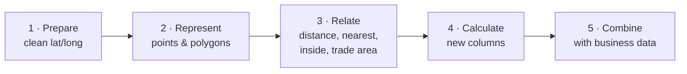
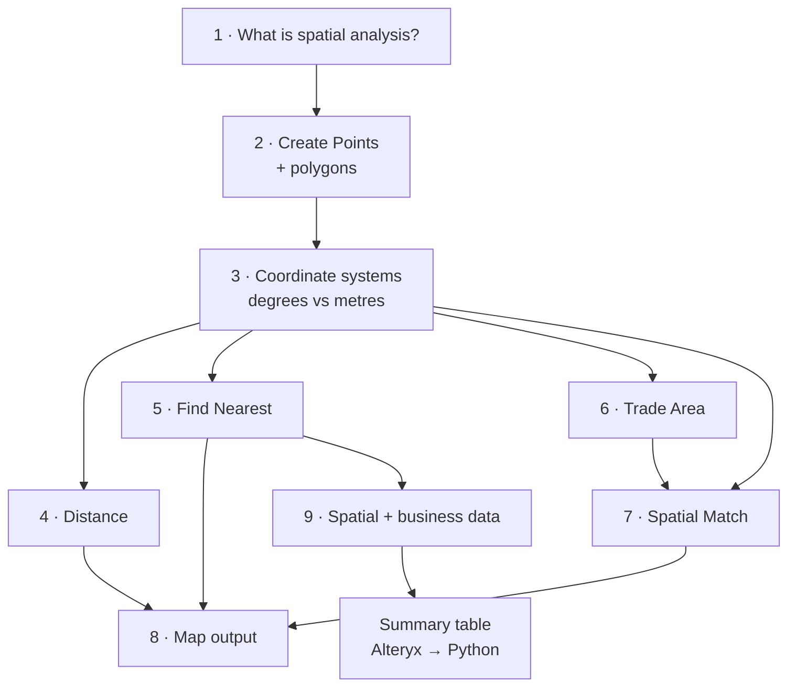
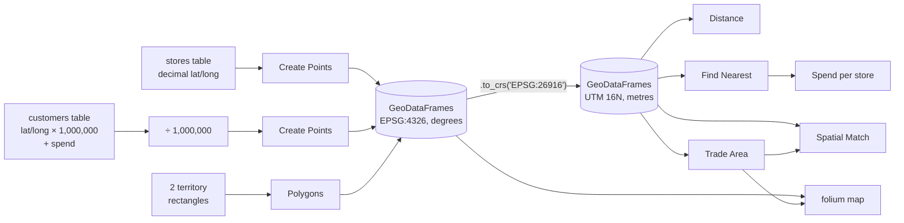
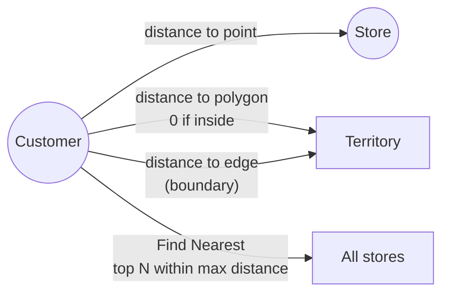
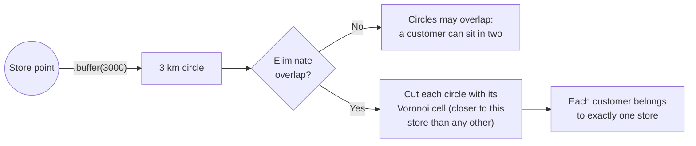
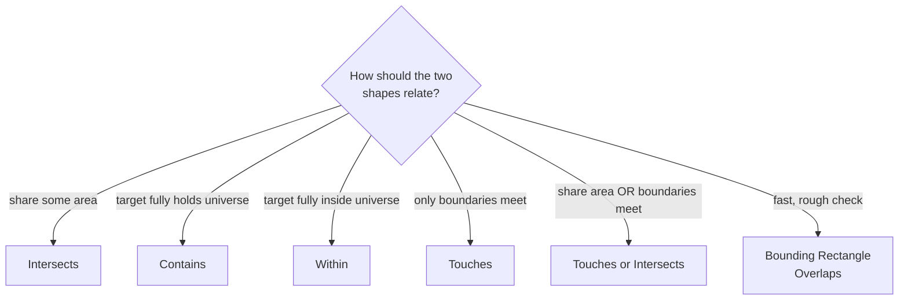
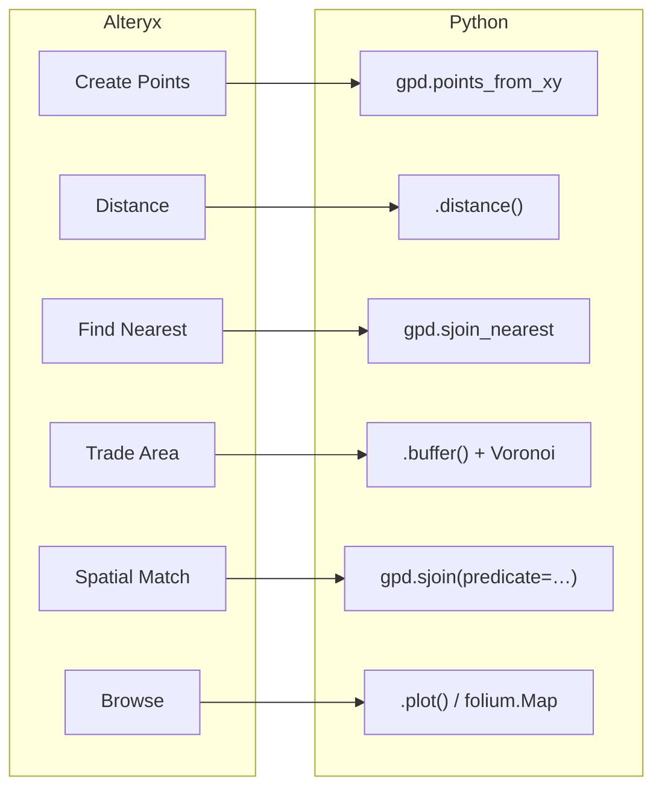

# Spatial Analysis Concepts: from Alteryx to Python

**Brown Belt I · Class 19 · Spatial Tools**

A beginner-friendly Jupyter notebook, [`spatial_analysis_concepts.ipynb`](spatial_analysis_concepts.ipynb), that re-creates the Alteryx Designer spatial tools from class in Python. It uses a tiny made-up dataset, **3 coffee shops and 8 customers in Chicago**, so every result fits on one screen.

Each section pairs:

1. a plain-language explanation that names the **matching Alteryx tool**, and
2. a short Python cell you can run, change and re-run.

No Python expertise needed: run the cells top to bottom with **Shift + Enter** and read the comments.

---

## What's in this folder

```text
brown-belt-1/
├── spatial_analysis_concepts.ipynb         # the notebook (outputs already saved)
├── README.md
├── LICENSE
└── .gitignore                              # keeps secret/ and .venv/ out of git
```

The class slides and the Alteryx reading (*What Is Spatial Analysis?*) are kept in a local `secret/` folder and are **not** in this repo; they're shared in class.

---

## The big idea: location is data

Spatial analysis treats a location as something you can **calculate with** and **join to business data**, not just a dot on a map. The notebook follows the five-step workflow from the reading:



---

## Notebook map



| # | Section | Alteryx tool | Question it answers |
|---|---|---|---|
| 1 | What is spatial analysis? | — | Why location matters for business questions |
| 2 | Create Points | **Create Points** | How do two number columns become a point on the map? |
| 3 | Coordinate systems | *(coordinate settings)* | Why can't I measure distance in degrees? |
| 4 | Distance | **Distance** | How far is each customer from Store A, or from a territory border? |
| 5 | Find Nearest | **Find Nearest** | Which store is closest to each customer, within 5 km? |
| 6 | Trade Area | **Trade Area** | What area does each store serve, with and without overlap? |
| 7 | Spatial Match | **Spatial Match** | Which territory is each customer in? Which customers are in each trade area? |
| 8 | Map output | **Browse** | What does it all look like on an interactive map? |
| 9 | Putting it together | — | Which store “owns” the most customer spend? |

---

## How the data flows

Two small tables become spatial tables, get converted to metres, then feed every tool:



> **Why convert to metres?** Latitude and longitude are angles. A degree of longitude gets shorter as you move away from the equator, so distances and buffers need a **projected** coordinate system in metres. The notebook uses `EPSG:26916` (UTM zone 16N), which is accurate around Chicago.

---

## The tools at a glance

### Distance and Find Nearest



Customer 8 is more than 5 km from every store, so Find Nearest returns **no match**. Section 9 flags that gap as a possible site for a new store.

### Trade Area: eliminating overlap



### Spatial Match: choosing an action



| Alteryx action | Python (shapely) | Notebook example |
|---|---|---|
| Intersects | `a.intersects(b) and not a.touches(b)` | overlapping squares |
| Contains | `a.contains(b)` | customers inside each trade area |
| Within | `a.within(b)` | territory of each customer |
| Touches | `a.touches(b)` | squares side by side |
| Touches or Intersects | `a.intersects(b)` | |
| Bounding Rectangle Overlaps | `a.envelope.intersects(b.envelope)` | L-shape vs. far square: boxes overlap, shapes don't |

---

## Alteryx → Python cheat sheet



| Python library | Plays the role of… |
|---|---|
| `pandas` | an Alteryx data stream (a table) |
| `shapely` | single shapes: points, polygons, distances |
| `geopandas` | a **spatial** data stream (a table with a geometry column) |
| `pyproj` | coordinate system conversions (used inside geopandas) |
| `matplotlib`, `folium` | the Browse tool's map view (static and interactive) |

---

## Run it

The notebook already contains its outputs, so you can **read it on GitHub or in VS Code without running anything**. To run it yourself:

First get the code:

```bash
git clone https://github.com/iportilla/brown-belt-1.git
cd brown-belt-1
```

### Option A: you already have a `.venv` with the libraries

(For example, the one in the instructor's original folder. A fresh clone doesn't include one; use Option B.) The `.venv` has every library the notebook needs, but not the JupyterLab app.

- **VS Code:** open the notebook and pick `.venv` as the kernel (top-right **Select Kernel**). Nothing else to install.
- **JupyterLab in the browser:** install it once, then start it:

```bash
source .venv/bin/activate
pip install jupyterlab        # first time only
jupyter lab spatial_analysis_concepts.ipynb
```

### Option B: a fresh setup

**macOS / Linux**

```bash
python3 -m venv .venv
source .venv/bin/activate
pip install geopandas shapely pyproj matplotlib folium jupyterlab
jupyter lab spatial_analysis_concepts.ipynb
```

**Windows (PowerShell)**

```powershell
py -m venv .venv
.venv\Scripts\Activate.ps1
pip install geopandas shapely pyproj matplotlib folium jupyterlab
jupyter lab spatial_analysis_concepts.ipynb
```

If PowerShell says scripts are disabled, run `Set-ExecutionPolicy -Scope CurrentUser RemoteSigned` once and activate again.

Tested with Python 3.12, geopandas 1.2, shapely 2.2, pandas 3.1 and folium 0.20.

---

## Try this next

- **Change the radius**: set `RADIUS_M` in section 6 to 1,500 or 5,000 and watch which customers each store keeps.
- **Change the search limit**: raise `max_distance` in section 5 so customer 8 gets a nearest store.
- **Add a store**: put a fourth store near customer 8 and re-run everything. How does spend per store change?
- **Break the coordinates**: swap latitude and longitude for one store and see where it lands on the map. This is the most common beginner mistake.

**Not covered** (but mentioned in the reading): geocoding addresses into coordinates, drive-time distance along real roads, and clustering / hotspot analysis.

---

## Troubleshooting

| Problem | Fix |
|---|---|
| `ModuleNotFoundError: geopandas` | The notebook isn't using `.venv`. Pick it as the kernel, or activate it before starting Jupyter. |
| Points show up in the ocean or Antarctica | Latitude and longitude are swapped. A point is `(longitude, latitude)`. |
| Distances look like 0.01 | You measured in degrees. Convert with `.to_crs("EPSG:26916")` first. |
| The interactive map is blank | Folium loads map tiles from the internet; check your connection or trust the notebook in Jupyter. |
| Layers don't line up | They're in different coordinate systems. Compare `gdf.crs` and convert one to match. |
